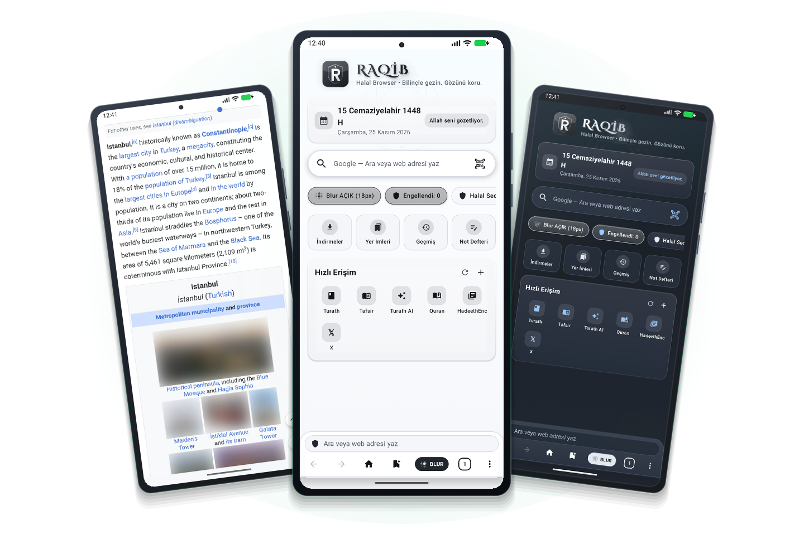

# RAQİB — Halal Visual Browser for Android

<p align="center">
  <strong>Bilinçle gezin. Gözünü koru.</strong><br/>
  <em>Browse with purpose. Protect your gaze.</em>
</p>

<p align="center">
  
  
  
  
  
</p>

<p align="center">
  
</p>

**RAQİB (الرقيب)** is an ultra-lightweight (`4.56 MB`), privacy-first Android web browser engineered for mindful, distraction-free, and fast browsing. It combines **instant zero-flash visual blur** with network-level ad, tracker, and explicit-domain shielding, native in-page translation, and 100% on-device privacy.

> **Official Distribution & Documentation Repository:** This public repository hosts the 5-language interactive showcase site (GitHub Pages & Vercel ready), official signed release APKs, SHA-256 checksums, 5-language Privacy Policy, and cryptographic verification details. Source code is proprietary (`All Rights Reserved`).

---

## Official Links

* **5-Language Showcase Website (Vercel):** https://raqib-browser.vercel.app/
* **5-Language Showcase Website (GitHub Pages):** https://talibtrb.github.io/raqib-browser/
* **Download Latest Signed APK (`v5.6.2`):** https://github.com/TalibTRB/raqib-browser/releases/latest
* **5-Language Privacy Policy (HTTPS):** https://talibtrb.github.io/raqib-browser/privacy.html
* **Security & Verification Policy:** [SECURITY.md](SECURITY.md)

---

## Complete Feature Overview

* **Instant Zero-Flash Strict Visual Blur (`t = 0 ms`):** Blurs ``, `<picture>`, `<canvas>`, `<video>` thumbnails, avatars, CSS backgrounds, and Shadow DOM media before paint. Hold any blurred image for instant **Peek-to-Unblur**, or manage per-site whitelist/blacklist rules and blur intensity (`0–40 px`).
* **Mandatory Halal Shield & Safe Browsing:** Permanent network-level blocking for explicit, gambling, and malicious domains; SafeSearch enforcement; IDN homograph phishing alerts; anti-cryptojacking shield; and dangerous download inspection.
* **Fast Aho-Corasick Ad, Tracker & Annoyance Shield:** Offline compiled binary trie (`< 8 ms` load) blocks ads, trackers, cookie banners, pop-ups, and app-nag bars while stripping URL tracking parameters automatically.
* **Native In-Page DOM Translation Engine:** Translates webpages directly in-place without leaving the page or breaking logins, with an instant floating `Original ↔ Translated` toggle bar.
* **Clean Guest Session (*Misafir / Temiz Oturum*):** Isolated Chromium `MULTI_PROFILE` session for a 2nd/family account or unbiased lookups with zero saved history, zero cache, hardware `FLAG_SECURE`, and always-on Strict Blur + Halal Shield.
* **Unified Dark & Light Mode Sync:** Synchronizes browser chrome, dialogs, and websites cleanly between Dark (white ink) and Light (black ink) while preserving visual blur clarity.
* **Pro In-Site Search & Smart Quick-Search Bangs:** Diacritics-tolerant in-page search with jump list, instant Omnibox quick-search chips (`Google`, `YouTube`, `Turath`, `Tafsir`, `Hadith`, `Almaany`), `!t` / `!tf` / `!h` / `!a` / `!yt` bangs, and offline calculator/unit/timezone converter.
* **Scholar & Productivity Suite:**
  * Pure Offline **Hijri Calendar**, **Hatim Tracker**, **Zakat & Hijri Converter**, and optional **Arabic Istighfar Reminder** popup
  * **Screenshot Studio** (straight strip highlighter, censor box, crop, arrows, annotations) & **Auto-Fit Quote Card Studio**
  * **Reader Mode**, **Text-Only Mode**, **Dual Split View**, **Offline Notes**, **Internal PDF Viewer & Save as PDF**, **QR Scanner & Generator**, **Element Zapper**, and **Tab Workspaces**
  * **Uninterrupted Web Audio & Media3 Suite:** Background audio/lecture playback, Voice Boost, 5-Band WebAudio EQ, playback speed, customizable bottom toolbar, and a 7-step interactive first-launch guided tour (with long-press gesture shortcuts)
* **100% On-Device Privacy & 5 Languages:** Zero accounts, zero analytics SDKs, hardware-backed Android Keystore (AES-GCM) encryption, `allowBackup=false`, built-in **Turkish (`tr`), English (`en`), Arabic (`ar` full RTL), Kurdish (`ku` Kurmancî), and German (`de`)**.

---

## Automatic Updates on Android (Obtainium)

You can track and install official signed RAQİB updates directly from GitHub Releases using **[Obtainium](https://obtainium.imranr.dev/)**:
1. Open Obtainium → **Add App**.
2. Enter: `https://github.com/TalibTRB/raqib-browser`
3. Obtainium automatically detects new signed APK releases and verifies cryptographic continuity against our permanent signing key.

---

## Verify Official Release Signatures

Every official APK published on GitHub Releases is signed with our permanent 4096-bit RSA key (`APK Signature Scheme v2 + v3`):

* **Package ID:** `com.raqib.browser`
* **Certificate `SHA-256`:** `F7:0D:88:EA:F2:AB:21:9C:2F:F8:72:6E:2C:D5:B6:EF:2F:9E:A7:93:0E:AF:5F:A8:D1:85:C3:13:95:BA:4C:A5`
* **Certificate `SHA-1`:** `26:CF:58:A0:70:C8:AD:52:54:1D:6F:A1:38:C2:F5:63:5F:8B:08:7C`

Verify locally:
```bash
sha256sum -c SHA256SUMS.txt
apksigner verify --verbose --print-certs RAQIB-v5.6.2-signed-release.apk
```

---

## Deploy Showcase to Vercel (1 Click)

This repository ships with a pre-configured [`vercel.json`](vercel.json) (`"outputDirectory": "docs"`, `"cleanUrls": true`, security & asset cache headers). Simply import `TalibTRB/raqib-browser` in [Vercel](https://vercel.com/new) and click **Deploy** — zero build step required.

---

## License

Copyright © 2026 **RAQİB Browser (`TalibTRB`)**. All Rights Reserved. See [LICENSE](LICENSE).
